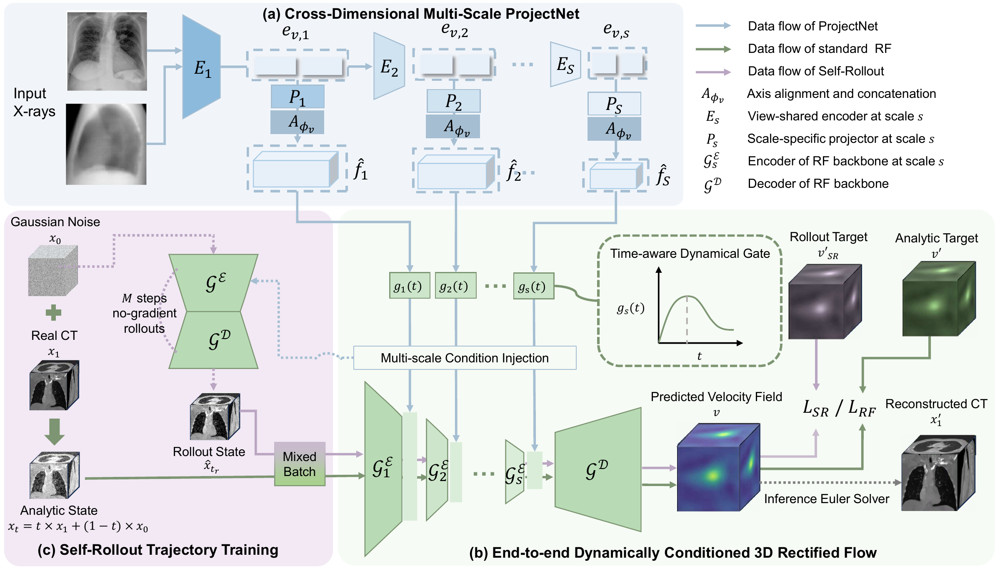

# RFX2CT

This is the PyTorch implementation of **RFX2CT: End-to-End Conditioned Rectified
Flow for CT Reconstruction from Few X-Rays**.

## Overall Framework

[](pictures/pipeline.pdf)

- **ProjectNet** extracts shared multi-scale X-ray features and lifts them into
  3D with view-shared progressive convolutional projectors. View angles are used
  only to align the lifted features with the CT axes.
- **Time-aware Dynamic Gate** controls the three-scale condition injection into
  the 3D RF Backbone.
- **Self-Rollout Trajectory Training** supervises intermediate model rollouts
  with endpoint-consistent velocity targets.

## Dataset

We use LIDC-IDRI and COLONOG with the following fixed splits:

| Dataset | Train | Validation | Test |
| --- | ---: | ---: | ---: |
| LIDC-IDRI | 814 | 102 | 102 |
| COLONOG | 626 | 79 | 79 |

Case lists are provided in `splits/`. Prepare the paired CT/X-ray HDF5 files
following [docs/DATA.md](docs/DATA.md). The model reconstructs 128 × 128 × 128 CT
volumes from a single frontal X-ray (`xray1`) or biplanar frontal/lateral
X-rays (`xray1`, `xray2`).

## How to Use

### Environment

Tested with Python 3.9 and PyTorch 1.13.1:

```bash
pip install -r requirements.txt
```

Run all commands below from the repository root. Datasets, checkpoints and
pretrained metric weights are not included in this repository.

### Training

| Dataset | Single-view | Biplanar-view |
| --- | --- | --- |
| LIDC-IDRI | `configs/lidc_single_view.yml` | `configs/lidc_biplanar.yml` |
| COLONOG | `configs/colonog_single_view.yml` | `configs/colonog_biplanar.yml` |

For LIDC-IDRI biplanar-view reconstruction, train with two GPUs:

```bash
torchrun --standalone --nproc_per_node=2 -m src.training.train \
  --config configs/lidc_biplanar.yml \
  --dataroot /path/to/LIDC-HDF5-256 \
  --out-dir checkpoints --tag rfx2ct_lidc_biplanar
```

The default settings are Adam with learning rate `1e-4`, 200 epochs, one case
per GPU, AMP and EMA. Self-Rollout starts after 20 epochs with probability 0.1
and two rollout steps. Time runs from noise (`t=0`) to CT (`t=1`).

For one GPU, replace `torchrun --standalone --nproc_per_node=2` with `python`
and add `--grad-accum-steps 2`. To resume, add
`--resume checkpoints/rfx2ct_lidc_biplanar/checkpoints/epoch_0100.pt`, keeping
the same configuration, split files and GPU count.

### Reconstruction

EMA weights and 25-step Euler sampling are used by default:

```bash
python -m src.inference.reconstruct \
  --checkpoint checkpoints/rfx2ct_lidc_biplanar/checkpoints/epoch_0200.pt \
  --dataroot /path/to/LIDC-HDF5-256 \
  --test-split splits/lidc/test.txt \
  --out-dir results/lidc_biplanar/CT \
  --sample-steps 25 --seed 20260629
```

Each case produces `fake_ct.mha`, `real_ct.mha` and sampling metadata. Noise
seeds are derived from the base seed and case ID. Use a new output directory
for each reconstruction run.

### Evaluation

Place `vgg16-397923af.pth`, `lpips_vgg_v0.1.pth` and
`inception_v3_google-0cc3c7bd.pth` in `metric_weights/`, then run:

```bash
python metric_tools/evaluate.py \
  --pred-root results/lidc_biplanar/CT \
  --value-space hu --eval-shape 128,128,128 --device cuda
```

Results are saved to `offline_metrics/metrics_per_sample.csv` and
`offline_metrics/metrics_summary.json` under the prediction directory.
Evaluation uses 3D PSNR/SSIM, VGG LPIPS and Inception FID. LPIPS/FID are
computed along all three slice directions. Optional per-label Dice evaluation
is available through `metric_tools/evaluate_segscore.py`; it requires
TotalSegmentator 2.0.5 and its weights.
